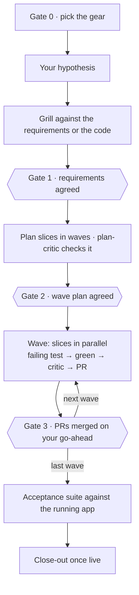

# Delivery Doctrine

A delivery method for Claude Code: agents that grill the problem before building it, slice the
work thin, write tests first, review their own work, and stop at every gate for your yes.

It right-sizes architecture to the problem (hexagonal and DDD only where they earn it), follows
your codebase's own conventions, and ships language profiles for Java, Go and Python.

## How it works

You say what you want built. Instead of jumping into code, the agent picks a **gear** and asks
for your hypothesis: your read of what the problem is. It then grills that read against the requirements, or against
the codebase if one exists, until the requirements are locked and you approve them.

Next it plans the work as **thin vertical slices**: each one a small behaviour that runs end to
end through every layer, the first being a walking skeleton: the thinnest path through every layer, wired and passing
before any feature. Slices that don't depend on each
other are grouped into **waves** that run in parallel, one implementer agent per slice, each in
its own git worktree. You approve the plan before any code is written.

Each implementer writes a failing test, makes it pass and commits; the lead opens the PR. A critic agent reviews
the slices that carry real design weight. When a wave's PRs are all open, you see them
together; on your go-ahead they merge, and the next wave starts. When the feature is live,
**close-out** folds the per-slice build notes into three lasting docs (plan, design, deferred
work), deletes the slice files, fact-checks the three, and updates the context file
(CLAUDE.md or AGENTS.md) of each part of the codebase the feature touched.



**Two gears.** *Full gear* is the flow above, for anything real. *Low gear* is for spikes, small
tasks and bug fixes: a short grill, a walking skeleton test-first, one critic pass, run,
commit. Low gear cuts ceremony, never correctness or architecture fit.

**Gates are hard stops.** At each gate the agent shows the result and waits. Silence, a partial
answer or "looks fine, but…" is not a yes.

## Quick start

```bash
claude plugin marketplace add https://github.com/vishalswami/delivery-doctrine
claude plugin install delivery-doctrine@delivery-doctrine
```

Start a new session and describe what you want to build. To check it loaded, ask "what gear
are we in?"; the agent answers from the doctrine.

Requires `python3`, `bash` and `git`. With the gear, Gate 0 picks a commit mode: **team** (a
branch and PR per slice; needs `gh`) or **solo** (commits straight to the local repository).

The plugin is built for Claude Code. The skills and agents are portable Markdown, but other
tools have no standard way to load them, and claude.ai and Cowork do not install a plugin with
a top-level `bin/`.

## What's inside

### Skills

Each skill loads on its own at the step that needs it; you never have to type one, though you
can (for example `/delivery-doctrine:grill-fast`) to jump straight to a step.

| Area | Skill | What it does |
|---|---|---|
| **Plan** | `grill-fast` | Greenfield requirements grill: batched questions, acceptance tests locked fast |
| | `grill-brownfield` | Grill against an existing codebase and its domain language; keeps each part of the codebase's glossary and decisions current as they are settled |
| | `thin-slice-planner` | Thin vertical slices in as few waves as possible, walking skeleton first |
| | `fast-path` | Low gear: the whole flow collapsed for small work |
| **Build** | `delivery-loop` | The per-wave loop: one worktree per slice, a ledger of what happened (the truth after a long session is compacted), bundled diffs for the critic, fix rounds, PRs, the wave gate |
| | `test-first` | Red, green, refactor; Given-When-Then structure; honest tests |
| | `acceptance-testing` | End-to-end tests through the real entry point, external systems stubbed |
| | `execution-hygiene` | Scoped local checks, evidence before claiming done |
| | `systematic-debugging` | Root cause before any fix; a reproduction test first |
| | `close-out` | After launch: consolidate, delete build notes, fact-check the docs |
| **Review** | `ddd-hexagonal-reviewer` | Is the architecture right-sized, and does it fit the codebase's existing conventions? |
| | `review-feedback` | Acting on critic, reviewer and bot comments; replying and resolving threads |
| **Present** | `narration-cue-map` | Keeps a live demo free of dead air while agents run |
| **Support** | `diagnose` | Why a session skipped a step: reads the `doctrine-diagnose` report against the doctrine, explains the likely cause, offers a scrubbed bundle for a bug report |

### Language profiles

| Language | Skills |
|---|---|
| Java | `java-domain`, `readable-java-style`, `gwt-testing`, `spring-boot`, `code-quality`, `concurrency-review`, `security-audit` |
| Go | `go-style`, `go-testing` (adapters, concurrency and security in `references/`) |
| Python | `python-style`, `pytest-testing` (adapters, concurrency and security in `references/`) |

A language profile loads before code in its language is written or reviewed, whether by a subagent or
the main session.

### Agents

| Agent | Role |
|---|---|
| `implementer` | Builds one slice to green, test-first; in full gear, in its own worktree |
| `critic` | Reviews a slice: spec compliance, then code quality and architecture, then gaps the spec missed |
| `plan-critic` | Checks the wave plan against the requirements before any code |

### Hooks

| Hook | What it does |
|---|---|
| Doctrine | Injects the method at session start, plus your profiles (below) |
| Guard | Blocks destructive commands (`rm -rf`, `sudo`, force-push, `git reset --hard`, …), wide local test runs and sleep-poll loops. It matches the raw command, so a commit message that merely mentions one is refused too; write the message to a file and use `git commit -F <file>`. Can be relaxed or turned off (see Switches) |
| Skill check | Before acting on each message, the agent writes a one-line YES/NO for the skills that could apply and loads every YES; candidates follow the repository's language. A written decision makes skill loading reliable where a plain reminder does not |
| Anchor | Past 150k tokens of context, restates five core rules next to each message, where a long context still attends to them |
| Keep-awake | macOS: stops the machine idle-sleeping while a session runs |

### Commands

| Command | What it does |
|---|---|
| `build-scratch` | Prints the orchestrating session's git-ignored scratch folder |
| `review-package` | Writes a slice's commits and diff to one file for the critic |
| `doctrine-diagnose` | Reports what the doctrine did in a session: gear, skills loaded and never loaded, subagents, guard denials, likely misses. `--bundle <file>` writes a scrubbed copy, with no message text, file contents or command text, to attach to a public issue |

Claude Code puts `bin/` on the Bash tool's path while the plugin is enabled, so the skills call
them by bare name. `doctrine-diagnose` takes a session id or a transcript path; with neither, it
reads the newest transcript of the current folder.

## Configure

Everything below is optional; without it the agents read the codebase and follow what they find.

### Repository profile

Facts about one repository live in that repository. Copy
[`templates/delivery-doctrine.md`](templates/delivery-doctrine.md) to:

- `.claude/delivery-doctrine.md`, shared with your team, or
- `.claude/delivery-doctrine.local.md`, just for you (gitignore it).

Fill in what applies: where specs live, files that parallel PRs must not both edit, how PRs are
opened and merged, how a fresh worktree is set up. It is injected after the doctrine, word for
word, so trust it as you would the repository's CLAUDE.md. A session in a git worktree falls back
to the main checkout's `.local.md` when the worktree has none. A repository profile that is a
symlink is ignored, so a cloned repository cannot point one at a private file.

### Personal profile and models

`~/.claude/delivery-doctrine.md` applies to every repository and is injected before the
repository's, so the repository profile wins where they disagree. Its `## Models` section maps the
doctrine's three model tiers to the models you have, and can go finer:

| Key | Covers | Default |
|---|---|---|
| `deep` | Domain code and every review | opus |
| `standard` | Mechanical code (migrations, wiring, generated code, rebases) and analysis | sonnet |
| `fast` | Lookups only (search, read a file, fetch a page) | haiku |
| `domain`, `review`, `mechanical`, `analysis`, `retrieval` | One kind of task | its tier |
| `implementer`, `critic`, `plan-critic` | One agent | its task's tier |

```markdown
## Models
- critic: fable
- mechanical: opus
```

Values are model aliases (opus, sonnet, haiku, fable). An agent entry beats a kind of task, which beats a tier.

### House conventions

The doctrine follows your codebase. Where the house has the same structure under other names,
the agents use the house's names; where a structure is missing, they introduce it. A house rule
that is plainly bad practice is named, with a better practice proposed for you to decide; it is
neither followed blindly nor quietly ignored.

### Switches

Set in the `env` block of `~/.claude/settings.json`.

| Variable | Default | Effect |
|---|---|---|
| `DOCTRINE_WIDE_TESTS=1` | off | Prefix one command to let a wide test run past the guard |
| `DOCTRINE_GUARD_HYGIENE=0` | on | Keep only the guard's destructive-command blocks; allow wide test runs and sleep-poll loops |
| `DOCTRINE_GUARD=0` | on | Turn the guard off entirely |
| `DOCTRINE_SKILL_CHECK=0` | on | Turn off the per-message skill check |
| `DOCTRINE_ANCHOR=0` | on | Turn off the long-session anchor |
| `DOCTRINE_ANCHOR_TOKENS` | `150000` | Context size at which the anchor starts |
| `DOCTRINE_KEEP_AWAKE=0` | on | Turn off keep-awake (macOS) |
| `DOCTRINE_LID_REMINDER=1` | off | Daily reminder when closing the lid would still sleep the Mac |

### Fewer permission prompts

The guard blocks a short list of destructive commands; it is not a sandbox. To cut prompts
while keeping edits gated, in `~/.claude/settings.json`:

```json
{
  "permissions": {
    "allow": ["Read", "Grep", "Glob", "Task", "TodoWrite", "WebFetch", "WebSearch",
              "Bash(build-scratch *)", "Bash(review-package *)"],
    "ask": ["Edit", "Write", "MultiEdit", "NotebookEdit"]
  }
}
```

Adding plain `"Bash"` to `allow` runs every shell command unasked, with only the guard's
blocklist as a brake. Do that only if you accept the risk.

## Verify and update

After installing or updating, in a fresh session:

- `/plugin` lists delivery-doctrine, enabled, with no errors.
- Ask "what gear are we in?"; the answer comes from the doctrine.
- `/hooks` shows the SessionStart, UserPromptSubmit and PreToolUse hooks.
- On a scratch branch, `git push --force` is refused, pointing to `--force-with-lease`.

To update:

```bash
claude plugin marketplace update delivery-doctrine
claude plugin update delivery-doctrine
```

Then restart your sessions; a running session keeps the version it started with. What changed
in each release is in [`CHANGELOG.md`](CHANGELOG.md).

To uninstall:

```bash
claude plugin uninstall delivery-doctrine
claude plugin marketplace remove delivery-doctrine
```

Nothing else is left behind except files you created yourself: `~/.claude/delivery-doctrine.md`,
any `.claude/delivery-doctrine*.md` repository profiles, and `DOCTRINE_*` entries you added to
`settings.json`.

## Principles

- **Gates over momentum.** Stop, show, wait for a yes.
- **Thin and vertical.** Every slice runs end to end; nothing speculative.
- **Test first, honestly.** A test that cannot fail proves nothing.
- **Right-sized architecture.** Patterns only where the problem has them; the house style wins.
- **Evidence over claims.** Nothing is done until the output says so.
- **No comments.** Names and structure carry the meaning; the reasons go to ADRs and test names.

## Contributing

Issues and pull requests are welcome. For a bug report, ask the agent why the session went wrong;
the `diagnose` skill explains it and offers a scrubbed bundle to attach.

The doctrine stays small on purpose, so new skills are usually declined: open an issue first
and say what failure it fixes that the existing skills don't. Fixes, sharper wording, better
examples and new eval cases are the most welcome. Pull requests written by an agent are fine
when a person has read and stands behind every line.

1. Fork the repository and work on a branch.
2. Keep to its conventions: no comments in code examples beyond the ✅/❌ labels that mark
   teaching examples, each `SKILL.md` at most 120 lines with
   depth in `references/`, plain wording, and credit in `THIRD_PARTY_NOTICES.md` for anything
   adapted from elsewhere.
3. Run the evals and add a case when your change alters behaviour:

   ```bash
   claude plugin eval . --scaffold --runs 3
   ```

   The cases in [`evals/`](evals/) check that the doctrine is injected, that a new feature names
   a gear and starts the grill, that the right skills load for a flaky test, review comments, a
   small change or a Java, Go or Python change, and that the agent never claims done without
   evidence.
4. If you touch `hooks/guard-bash.sh`, run its regression suite and add a case for the
   command you changed it for. CI runs it on Linux and macOS for every pull request:

   ```bash
   python3 -I tests/guard.py
   ```

   Each case states whether the guard must deny or allow it, and cases that should be
   harmless also run through real bash with stubbed programs, to prove nothing destructive
   executes.
5. If you touch `bin/doctrine-diagnose`, run `python3 -I tests/diagnose.py`. Its fixtures in
   `tests/fixtures/` are synthetic; never commit a real transcript.
6. Open a pull request that says what changed and why.

### Releasing (maintainer)

Bump `version` in `.claude-plugin/plugin.json`, add the release to `CHANGELOG.md`, tag it,
and merge to `main`. The marketplace follows
`main`, so users get the release with `claude plugin update`.

## License and credits

MIT, see [`LICENSE`](LICENSE). Adapted with thanks from:

- Jesse Vincent's [superpowers](https://github.com/obra/superpowers) (MIT): the delivery loop,
  test-first, execution-hygiene, systematic-debugging and review-feedback skills, the
  implementer and critic agents, parts of thin-slice-planner and plan-critic, and the two
  commands.
- Matt Pocock's [skills](https://github.com/mattpocock/skills) (MIT): grill-brownfield.
- Piotr Mińkowski's [claude-ai-spring-boot](https://github.com/piomin/claude-ai-spring-boot)
  (Apache-2.0): code-quality and spring-boot.
- Decebal Suiu's [claude-code-java](https://github.com/decebals/claude-code-java) (MIT):
  concurrency-review and security-audit.

Details in [`THIRD_PARTY_NOTICES.md`](THIRD_PARTY_NOTICES.md).
